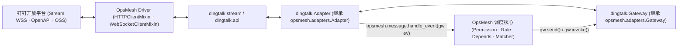

# opsmesh-adapter-dingtalk

面向 **[OpsMesh](https://github.com/jhupo/OpsMesh)** 的原生全异步钉钉 Stream 协议适配器（导入包名：`dingtalk`）。

本项目 **100% 遵循并复用 OpsMesh 核心原语**（`Adapter`、`Gateway`、`Event`、`Message`、`MessageSegment`、`handle_event`、`get_plugin_config`、`AdapterException`、`logger`），不创造任何平行重复抽象，亦不引入官方 `dingtalk-stream` 同步阻塞 SDK，完全通过 OpsMesh `Driver`（`HTTPClientMixin` + `WebSocketClientMixin`）实现钉钉 **Stream 反向长连接协议**与 **OpenAPI / OAPI** 全套能力。

---

## 核心特性

- **100% 原生衔接 OpsMesh 管线**：
  - 事件模型直接继承 `opsmesh.adapters.Event`，入站统一交由 `opsmesh.message.handle_event(gateway, event)` 进入框架的 `PreProcessor -> TrieRule -> Permission -> Rule -> Depends -> Matcher` 标准调度；
  - 消息模型直接继承 `opsmesh.adapters.{Message, MessageSegment}`，原生享有 `+` 拼接、按类型切片 `msg["image"]`、`extract_plain_text()`、`Message.template()` 与 Pydantic v2 校验；
  - 所有网关出站调用统一走 `Gateway.invoke()` -> `Adapter._invoke()`，完整支持 `@Gateway.before_invoke`、`@Gateway.after_invoke` 与 `MockInvokeResult`。
- **多机器人网关隔离**：支持单进程同时挂载多个钉钉机器人（`gateway.id = "dingtalk:{robot_code}"`），独立维护 WSS 会话、双检锁 `TokenManager` 与 `LRU+TTL` 去重环。
- **全模态与智能双通道路由**：覆盖 `text`、`richText`、`picture`、`file`、`audio`（含 `recognition` 语音转文字）、`video`、`markdown`、`action_card`；`Gateway.send()` 自动在 `sessionWebhook` 与 OpenAPI 间择优路由并自动拆分混排批次。
- **GB 级大文件流式收发**：入站通过阿里云 OSS 签名直链实现 **最高 4GB 恒定低内存流式落盘 + `Range` 断点续传**；出站 ≤ 20MB 走 `media/upload` 原生气泡，> 20MB 支持群钉盘 `convFile` 流式直传 OSS。
- **互动卡片回调与 AI 流式卡片**：内置 **2.0 秒窗口同步 ACK 局部刷新 + 超时自动先 ACK 转 OpenAPI 异步刷新** 双路径；提供带节流合并与异常自动收尾的 `gateway.ai_card_stream()`。

---

## 系统架构总览



---

## 模块化源码架构（`src/dingtalk/`）

按职责拆分为 **顶层编排层 + 4 个高内聚领域子包**，每个文件严格控制在单一职责（80~180 行规模），顶层 `__init__.py` 提供扁平门面导出：

```text
opsmesh-adapter-dingtalk/
├── .github/workflows/              # CI (Linux/Windows × Py3.11-3.13) · CodeQL · Security · Release
├── docs/                           # 完整架构、状态机、流程图与时序图设计文档
│   ├── 01-architecture.md
│   ├── 02-stream-protocol-and-flows.md
│   ├── 03-media-and-large-files.md
│   └── 04-cards-and-streaming.md
├── examples/stream_bot/            # 纯客户端模式运行示例骨架
├── src/dingtalk/                   # 顶层包 (from dingtalk import Adapter, Gateway, ...)
│   ├── __init__.py                 # 统一公开导出门面 (__all__)
│   ├── py.typed                    # PEP 561 静态类型支持标记
│   ├── config.py                   # BotConfig / Config (对接 opsmesh.get_plugin_config)
│   ├── exception.py                # 异常层次 (继承 opsmesh.exception.AdapterException 族)
│   ├── typing.py                   # Python 3.11+ StrEnum 枚举、TypeAlias 与 TypedDict 协议契约
│   ├── utils.py                    # 日志封装 (复用 opsmesh.log.logger) 与有界 DedupeRing
│   ├── event/                      # [事件子包] 继承 opsmesh.adapters.Event
│   │   ├── __init__.py
│   │   ├── base.py                 # DingTalkEvent 基类与 LifecycleMetaEvent (meta_event)
│   │   ├── models.py               # AtUser · UserProfile · RoleItem 值模型
│   │   ├── message.py              # MessageEvent / PrivateMessageEvent / GroupMessageEvent
│   │   ├── card.py                 # CardCallbackEvent (含 2.0s ACK 信号槽)
│   │   └── notice.py               # PlatformNoticeEvent (企业 EVENT:* 订阅)
│   ├── message/                    # [消息子包] 继承 opsmesh.adapters.{Message, MessageSegment}
│   │   ├── __init__.py
│   │   ├── segment.py              # Message 与 MessageSegment 8 类静态工厂方法
│   │   ├── parser.py               # 入站 JSON -> Message 解析器 (零网络 I/O)
│   │   └── serializer.py           # 出站 Message -> sessionWebhook / OpenAPI 批次编译器
│   ├── stream/                     # [Stream 协议子包] 纯异步 WSS 连接管理
│   │   ├── __init__.py
│   │   ├── protocol.py             # 握手载荷、SYSTEM/CALLBACK/EVENT 帧与 AckMessage 编解码
│   │   └── session.py              # 单机器人 WSS 状态机、0s 摘流重连与指数退避保活
│   ├── api/                        # [服务端 API 与媒体/卡片子包] 供 Adapter._invoke 调用
│   │   ├── __init__.py
│   │   ├── token.py                # TokenManager (anyio.Lock 双检锁续期)
│   │   ├── client.py               # ApiClient (api.dingtalk.com / oapi 统一请求与错误解码)
│   │   ├── media.py                # OSS 直链流式落盘 + Range 续传、media/upload、钉盘直传
│   │   ├── card.py                 # 互动卡片投放/更新与 AICardStream 节流上下文管理器
│   │   └── contact.py              # 通讯录 topapi/v2/user/get 与 TTL 内存缓存
│   ├── gateway.py                  # 薄门面 Gateway (~130 行): send 智能选路 + 强类型方法全走 self.invoke
│   └── adapter.py                  # 薄编排 Adapter (~140 行): 托管多 StreamSession、派发 handle_event 与 _invoke
└── tests/unit/                     # 分模块单元测试套件
```

---

## 设计文档导航

1. **[01-architecture.md](docs/01-architecture.md)** — OpsMesh 原生机制复用边界、4 子包分层与单向依赖 DAG、核心类图、Python 3.11+ 语法与封装规范、配置与动作契约。
2. **[02-stream-protocol-and-flows.md](docs/02-stream-protocol-and-flows.md)** — Stream 状态机、心跳与灰度摘流 0s 重连时序、入站幂等去重与消息解析流程、出站双通道路由、员工鉴权时序。
3. **[03-media-and-large-files.md](docs/03-media-and-large-files.md)** — 4GB 大文件 OSS 流式落盘与 `Range` 续传时序、SSRF 防护流、出站 ≤ 20MB 与 > 20MB 钉盘双通道时序。
4. **[04-cards-and-streaming.md](docs/04-cards-and-streaming.md)** — 互动卡片回调 2.0s 抢占双模式时序与 AI 流式打字机卡片生命周期时序。

---

## 开源许可

本项目采用 [MIT License](LICENSE) 开源。
