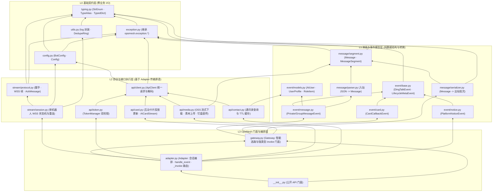
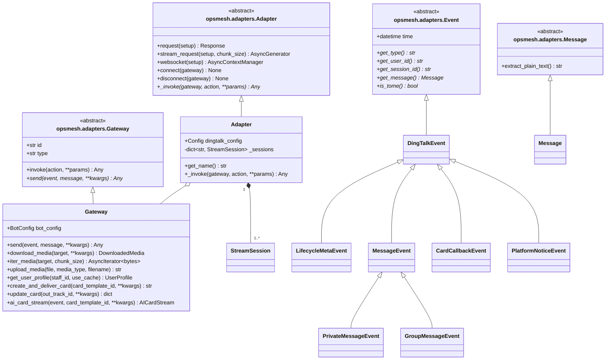

# 01. 总体架构、OpsMesh 原生对齐、模块边界与 Python 3.11+ 规范

本文档定义 `opsmesh-adapter-dingtalk`（顶层包名 `dingtalk`）如何 **100% 复用 OpsMesh 核心基础设施**、如何划分 `src/dingtalk/` 内部子包防止代码堆砌，以及全库遵循的 Python 3.11+ 语法与面向对象封装契约。

---

## 1. 第一原则：100% 走 OpsMesh 框架，绝不另造平行体系

适配器只负责**“钉钉协议编解码与通道保活”**，一切框架级能力直接继承和调用 OpsMesh 标准原语：

| 能力域 | 严禁重复造轮子的做法 | 本项目标准做法（100% 走 OpsMesh） |
| :--- | :--- | :--- |
| **事件基类与分发** | 自建事件总线、自定义回调注册表 | 所有事件直接继承 `opsmesh.adapters.Event`，入站统一调用 `await opsmesh.message.handle_event(gateway, event)`，无缝触发 `on_message` / `on_command` / `on_notice` / `on_metaevent` / `on_type` |
| **多模态消息容器** | 自建 Attachment/Content 列表类 | 直接继承 `opsmesh.adapters.{Message, MessageSegment}`，直接复用基类的 `+` 拼接、`msg["image"]` 按类型索引、`in`、`include`/`exclude`、`extract_plain_text()`、`Message.template()` 与 Pydantic v2 校验器 |
| **规则、权限与依赖注入** | 自定义命令解析器或权限装饰器 | 直接使用 `opsmesh.rule`（`to_me()`、`command()` 等）、`opsmesh.permission`（`SUPERUSER` 自动匹配 `"dingtalk:{user_id}"`）与 `opsmesh.params`（`EventMessage()`、`CommandArg()`、`Depends()`） |
| **出站调用与拦截钩子** | `Gateway` 方法直接裸调 HTTP 绕过框架 | `Gateway` 上所有业务方法（含 `send_group_message`、`download_media`、`get_user_profile`、`update_card` 等）**内部一律调用 `await self.invoke(action, ...)` -> `Adapter._invoke()`**，100% 经过 `@Gateway.before_invoke` / `@Gateway.after_invoke` 与 `MockInvokeResult` |
| **网络传输底座** | 引入 `requests`、`dingtalk-stream` 或自建 `httpx.AsyncClient` | 100% 调用 `Adapter.request()`、`Adapter.stream_request()`、`Adapter.websocket()`（底层由宿主配置的 `~httpx+~websockets` 或 `~aiohttp` 驱动提供） |
| **生命周期与并发** | `asyncio.create_task` 裸跑后台野协程 | 统一绑定 `driver.on_startup` / `driver.on_shutdown`，所有并发协程挂载到 `driver.task_group`，就绪/下线严格调用 `gateway.connect()` / `gateway.disconnect()` |
| **配置、异常与日志** | 自建配置读取器、裸继承 `Exception`、自建 `logging` | 配置通过 `opsmesh.get_plugin_config(Config)` 读取；异常继承 `opsmesh.exception.{AdapterException, ActionFailed, NetworkError, ActionNotAvailable, NoLogException}`；日志使用 `opsmesh.log.logger` + `escape_tag` |

---

## 2. 模块化子包划分与单向依赖设计（拒绝单文件堆砌）

将 `src/dingtalk/` 划分为 **顶层基础契约 + 4 个正交领域子包（`event`、`message`、`stream`、`api`）+ 顶层薄编排层（`gateway`、`adapter`）**，每个文件聚焦单一职责（控制在 80~180 行），同时在 `src/dingtalk/__init__.py` 提供扁平重导出，外部调用依旧只需 `from dingtalk import Adapter, Gateway, Message, MessageSegment, MessageEvent`。

### 2.1 子包职责与单向无环依赖图（DAG）

### 2.2 全量文件职责清单

| 子包 / 文件 | 核心职责说明 |
| :--- | :--- |
| `typing.py` | 定义 `FrameType`、`StreamTopic`、`DingTalkMsgType`、`MediaType`、`SpaceType` 等 `StrEnum` 及钉钉原始 JSON 的 `TypedDict` 类型标注 |
| `exception.py` | 继承 `opsmesh.exception`：`DingTalkAdapterException`、`DingTalkNetworkError`、`DingTalkActionFailed`、`MediaLimitExceeded`、`StreamProtocolError` |
| `config.py` | `BotConfig`（`SecretStr` 保护密钥）与 `Config`（多账号唯一性校验、流式参数、缓存 TTL） |
| `utils.py` | 基于 `opsmesh.log.logger` 的带标签日志器 `log()`，以及基于 `OrderedDict + time.monotonic()` 的 `DedupeRing` |
| `message/segment.py` | 继承 `opsmesh.adapters.{Message, MessageSegment}`，提供 `text`/`at`/`markdown`/`image`/`file`/`audio`/`video`/`action_card` 8 个强类型工厂方法 |
| `message/parser.py` | 纯函数解析入站 `msgtype` 为 `Message`（兼容 `downloadCode` 与 `pictureDownloadCode`、处理群 `@` 前导空白、未知类型保底段） |
| `message/serializer.py` | 纯函数编译 `Message` 为 `sessionWebhook` JSON 或有序的 OpenAPI `(msgKey, msgParam)` 批次列表 |
| `event/base.py` | `DingTalkEvent(opsmesh.adapters.Event)` 抽象基类 + 连接就绪/重连元事件 `LifecycleMetaEvent`（`get_type() -> "meta_event"`，默认 `NoLogException` 静默） |
| `event/models.py` | `AtUser`、`RoleItem`、`UserProfile`、`DownloadedMedia` 等不可变值模型 |
| `event/message.py` | `MessageEvent`、`PrivateMessageEvent`、`GroupMessageEvent`（封装 `is_tome()`、群+人会话 ID、员工身份字段） |
| `event/card.py` | `CardCallbackEvent`（`get_type() -> "notice"`，内置 `anyio.Event` 信号槽与 `reply_card()` / `ack_card()`） |
| `event/notice.py` | `PlatformNoticeEvent`（`get_type() -> "notice"`，承载 `EVENT:*` 企业事件通知） |
| `stream/protocol.py` | 开票请求构造、WSS URL 安全校验、`StreamFrame` 解析与 `AckMessage` JSON 序列化 |
| `stream/session.py` | `StreamSession`：单机器人握手循环、`SYSTEM/ping` 自动回复、`SYSTEM/disconnect` 0s 无缝重连、异常指数退避重连与 `CancelScope` 安全关停 |
| `api/client.py` | `ApiClient`：统一封装 `api.dingtalk.com`（Header 鉴权）与 `oapi.dingtalk.com`（Query 鉴权）请求、超时与错误转换 |
| `api/token.py` | `TokenManager`：单网关 `anyio.Lock` 双检锁 `access_token` 内存缓存（提前 300s 续期） |
| `api/media.py` | `MediaService`：OSS 直链换取、无损 HTTPS 升级、逐跳白名单校验、`.part` 流式落盘 + `Range` 续传、`iter_media`、`media/upload` 与钉盘 `convFile` 大文件直传 |
| `api/card.py` | `CardService` + `AICardStream`：自动推导 `openSpaceId`、强制注入 `callbackType="STREAM"`、150ms 令牌节流缓冲与 `__aexit__` 终态保证 |
| `api/contact.py` | `ContactService`：`topapi/v2/user/get` 查询与有界 TTL 缓存 |
| `gateway.py` | 继承 `opsmesh.adapters.Gateway`：实现 `send()` 智能双通道选路，暴露类型完备的业务方法并全部委托给 `self.invoke(...)` |
| `adapter.py` | 继承 `opsmesh.adapters.Adapter`：校验驱动 Mixin、编排多个 `StreamSession`、协调卡片 2.0s ACK 抢占、调用 `handle_event()`、实现 `_invoke()` 分发表 |

---

## 3. Python 3.11+ 语法与面向对象封装规范

全库源码严格对齐 `OpsMesh` 主仓的现代 Python 3.11+ 代码标准：

1. **类型系统与重写标记**：
   - 全面使用 PEP 604 联合类型 `X | Y | None`（且遵循 Ruff `RUF036` 将 `None` 置于联合末尾）与 PEP 585 内置泛型 `list[...]`、`dict[...]`、`tuple[...]`；
   - 子类覆盖父类/抽象基类方法时统一标注 `from typing_extensions import override` 的 `@override` 装饰器（兼容 Python 3.11~3.13 静态检查）；
   - 返回当前类实例的链式或工厂方法统一使用 `typing.Self`。
2. **枚举与模式匹配**：
   - 所有协议字面量采用 Python 3.11 原生 `enum.StrEnum`（可直接作为 `str` 参与 JSON 序列化与比较）；
   - Stream 帧类型路由（`SYSTEM` / `CALLBACK` / `EVENT`）与出站段编码采用 `match / case` 结构化模式匹配。
3. **数据建模分层**：
   - **外部 JSON 边界**（配置、入站 Event、通讯录响应）：使用 **Pydantic v2 `BaseModel`**，通过 `ConfigDict(populate_by_name=True, extra="allow")` 与 `Field(alias="senderStaffId")` 完成驼峰到 Python `snake_case` 的声明式映射，密钥一律使用 `SecretStr`；
   - **内部高频流转对象**（`DownloadedMedia`、`StreamFrame`、`OutboundBatch`）：使用 `@dataclass(slots=True, kw_only=True, frozen=True)`，消除动态 `__dict__` 开销并保证不可变安全。
4. **结构化并发与异常组**：
   - 统一基于 `anyio` 原语（`create_task_group`、`CancelScope`、`Lock`、`Event`、`move_on_after`、`open_file`）与 Python 3.11 原生 `except*`，不混用裸 `asyncio.ensure_future`。
5. **严格的访问控制与导出边界**：
   - 所有内部状态字段（如 `Gateway._token_manager`、`Adapter._sessions`、`CardCallbackEvent._ack_event`）一律使用单下划线私有命名（Pydantic 模型内部运行态字段使用 `PrivateAttr`）；
   - 每个包的 `__init__.py` 显式声明 `__all__`，确保 IDE 自动补全与类型导出干净清晰。

---

## 4. 核心类关系图

---

## 5. 配置项契约（`src/dingtalk/config.py`）

### 5.1 单机器人配置 `BotConfig`

| 字段名 | 类型 | 默认值 | 说明 |
| :--- | :--- | :--- | :--- |
| `client_id` | `str` | 必填 | 钉钉企业内部应用 `AppKey` / `Client ID` |
| `client_secret` | `SecretStr` | 必填 | 应用 `AppSecret` / `Client Secret`（掩码保护） |
| `robot_code` | `str \| None` | `None` | 机器人编码，未填时默认使用 `client_id` |
| `subscribe_card_callbacks` | `bool` | `True` | 握手时是否订阅 `/v1.0/card/instances/callback` 卡片回调 |
| `subscribe_events` | `bool` | `False` | 握手时是否额外订阅 `EVENT:*` 企业级事件通知 |
| `operator_union_id` | `str \| None` | `None` | 可选默认操作人 `unionId`（供主动推送 > 20MB 钉盘群文件使用） |

### 5.2 全局适配器配置 `Config`

| 字段名 | 类型 | 默认值 | 说明 |
| :--- | :--- | :--- | :--- |
| `dingtalk_bots` | `list[BotConfig]` | `[]` | 机器人列表（通过 `opsmesh.get_plugin_config(Config)` 自动解析 `.env`） |
| `dingtalk_api_base` | `str` | `"https://api.dingtalk.com"` | 新版钉钉 OpenAPI 根地址 |
| `dingtalk_oapi_base` | `str` | `"https://oapi.dingtalk.com"` | 旧版钉钉 OAPI 根地址（用于 `media/upload` 与 `topapi`） |
| `dingtalk_max_download_bytes` | `int \| None` | `None` | 入站下载单文件字节上限；**默认 `None` 不封顶**（支持 4GB 大文件） |
| `dingtalk_download_chunk_size` | `int` | `262144` | 流式下载分块大小（默认 256 KiB） |
| `dingtalk_download_read_timeout` | `float` | `60.0` | 流式下载单次读取空闲超时（秒，非总耗时封顶） |
| `dingtalk_allowed_download_domains` | `tuple[str, ...]` | `("dingtalk.com", "alicdn.com", "aliyuncs.com", "ddurl.cn")` | 附件下载逐跳允许的 HTTPS 域名后缀白名单 |
| `dingtalk_card_ack_timeout` | `float` | `2.0` | 互动卡片回调等待同步业务响应的最大窗口（秒） |
| `dingtalk_dedupe_capacity` | `int` | `2048` | 单网关已处理 `messageId` 去重表容量 |
| `dingtalk_dedupe_ttl` | `float` | `600.0` | `messageId` 去重记录保留时长（秒） |
| `dingtalk_user_cache_ttl` | `float` | `300.0` | `get_user_profile` 通讯录查询结果缓存时长（秒） |
| `dingtalk_reconnect_max_delay` | `float` | `30.0` | Stream WS 异常断线指数退避上限（秒） |

---

## 6. 出站动作路由全表（`Gateway.invoke` -> `Adapter._invoke`）

| `action` 名称 | 底层执行服务 (`api/`) | 返回值 | 对应钉钉接口 |
| :--- | :--- | :--- | :--- |
| `get_access_token` | `TokenManager.get_token()` | `str` | `POST /v1.0/oauth2/accessToken` |
| `send_session_webhook` | `ApiClient.post_webhook()` | `dict` | `POST {event.session_webhook}` |
| `send_group_message` | `ApiClient.request_openapi()` | `dict` | `POST /v1.0/robot/groupMessages/send` |
| `send_private_message` | `ApiClient.request_openapi()` | `dict` | `POST /v1.0/robot/oToMessages/batchSend` |
| `download_media` | `MediaService.download_to_disk()` | `DownloadedMedia` | `POST /v1.0/robot/messageFiles/download` + OSS 流式 `GET` |
| `upload_media` | `MediaService.upload_media()` | `str` (`media_id`) | `POST /media/upload` (`oapi`) |
| `send_dingpan_file` | `MediaService.send_dingpan_file()` | `dict` | `convFile` + `storage/.../uploadInfos` + OSS 流式 `PUT` |
| `get_user_profile` | `ContactService.get_user()` | `UserProfile` | `POST /topapi/v2/user/get` (`oapi`) |
| `create_and_deliver_card` | `CardService.create_and_deliver()` | `dict` | `POST /v1.0/card/instances/createAndDeliver` |
| `update_card` | `CardService.update_card()` | `dict` | `PUT /v1.0/card/instances` |
| `stream_card` | `CardService.stream_card()` | `dict` | `PUT /v1.0/card/streaming` |
