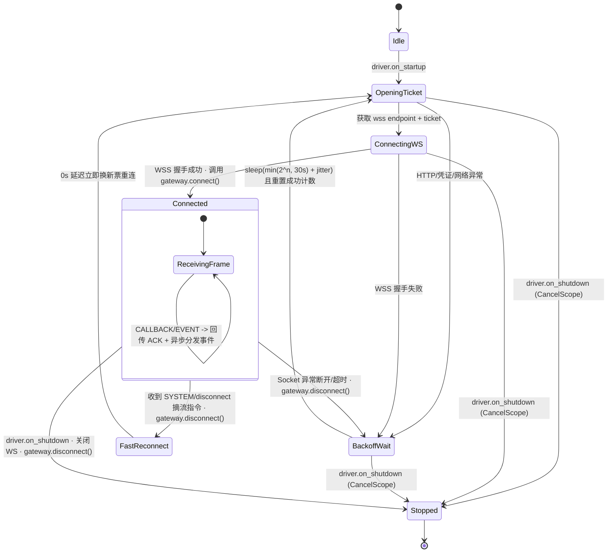
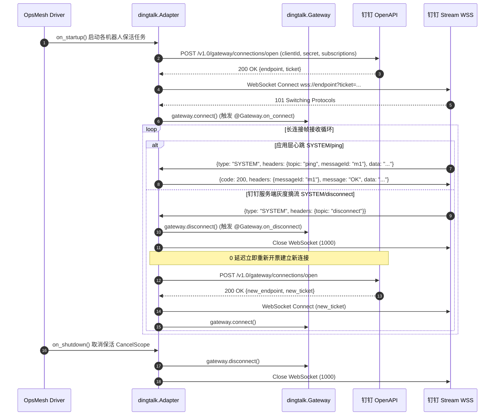
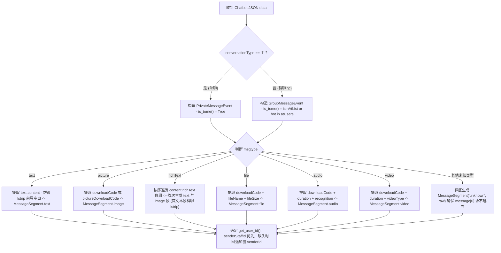
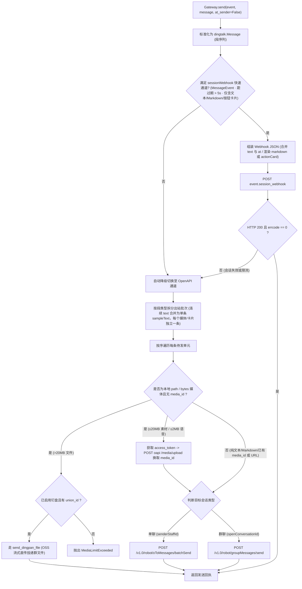
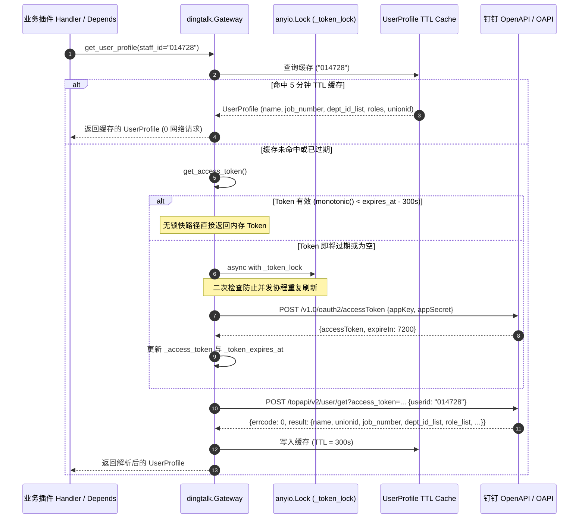

# 02. Stream 协议状态机与消息收发全链路时序设计

本文档详细定义钉钉 Stream 长连接生命周期、帧级状态流转、入站消息归一化、幂等去重、出站智能双通道选路与用户信息鉴权流程。

---

## 1. Stream 协议握手与帧结构规范

### 1.1 连接开票请求
- **Endpoint**：`POST https://api.dingtalk.com/v1.0/gateway/connections/open`
- **Request JSON**：
  ```json
  {
    "clientId": "dingxxxxxxxx",
    "clientSecret": "<secret>",
    "subscriptions": [
      {"type": "CALLBACK", "topic": "/v1.0/im/bot/messages/get"},
      {"type": "CALLBACK", "topic": "/v1.0/card/instances/callback"}
    ],
    "ua": "opsmesh-adapter-dingtalk/0.1.0"
  }
  ```
- **安全校验**：返回的 `endpoint` 必须满足 `scheme == "wss"`、存在合法主机名且不含明文用户信息，随后拼接 `?ticket={ticket}` 通过 `Adapter.websocket()` 建立连接。

### 1.2 下行帧与上行 `AckMessage` 结构

| 帧 `type` | `headers.topic` | 含义与适配器响应策略 |
| :--- | :--- | :--- |
| `SYSTEM` | `ping` | 应用层探活帧：原样将 `data` 放入 `AckMessage(code=200)` 立即回传 |
| `SYSTEM` | `disconnect` | 钉钉网关灰度发布/负载均衡摘流预告：关闭当前 socket 并 **0 延迟立即重新开票重连** |
| `CALLBACK` | `/v1.0/im/bot/messages/get` | 机器人单聊/群聊消息：**先立即回传 `AckMessage(200)`**，经 `msgId` 幂等校验后投入后台 `TaskGroup` 执行 `handle_event` |
| `CALLBACK` | `/v1.0/card/instances/callback` | 互动卡片点击回调：进入 **2 秒同步抢占窗口**（支持随 ACK 返回 `cardData` 局部刷新，超时先回过渡 ACK 再异步调 OpenAPI） |
| `EVENT` | 具体事件名（订阅 `*` 时） | 企业组织/OA 事件：**先立即回传 `AckMessage(200)`**，经 `eventId` 幂等校验后派发 `PlatformNoticeEvent` |

---

## 2. 连接生命周期状态机



---

## 3. 时序图 1：连接启动、心跳、灰度摘流无缝重连与优雅关停



---

## 4. 时序图 2：入站机器人消息异步处理与幂等去重

钉钉 Stream 若在数秒内未收到 WebSocket `AckMessage` 会触发重投。为防止耗时业务（如执行自动化脚本、调用大模型）阻塞读取协程或导致重复执行，适配器严格采用 **“先立即 ACK + 内存环形去重 + 后台并发执行”** 管线：

```mermaid
sequenceDiagram
    autonumber
    participant WSS as 钉钉 Stream WSS
    participant ADP as dingtalk.Adapter
    participant DED as DedupeRing (LRU+TTL)
    participant PAR as Event/Message Parser
    participant CORE as OpsMesh handle_event()
    participant PLG as 业务插件 Matcher

    WSS->>ADP: CALLBACK (/v1.0/im/bot/messages/get, messageId="f_01", data={msgId: "msg_99", ...})
    ADP->>WSS: 立即回传 AckMessage(code=200, messageId="f_01", data='{"response":null}')

    ADP->>DED: seen_or_record("f_01" / "msg_99")
    alt 已在 TTL (600s) 窗口内处理过
        DED-->>ADP: True (重复投递帧)
        Note over ADP: 记录 debug 日志并直接丢弃，防止重复触发命令
    else 首次到达
        DED-->>ADP: False (登记时间戳)
        ADP->>PAR: parse_chatbot_callback(data)
        Note over PAR: 识别单聊与群聊 · 拆解多模态段 · 剥离群 @ 前导空格 · 附件仅存 downloadCode 元信息
        PAR-->>ADP: PrivateMessageEvent / GroupMessageEvent
        ADP->>CORE: driver.task_group.start_soon(handle_event, gateway, event)
        CORE->>PLG: Permission -> Rule (to_me / command) -> Depends -> Handler
    end
```

---

## 5. 入站消息归一化流程（`message.py` & `event.py`）



---

## 6. 出站消息智能双通道选路流程（`Gateway.send`）



---

## 7. 时序图 3：`access_token` 双检锁刷新与员工通讯录 RBAC 鉴权


