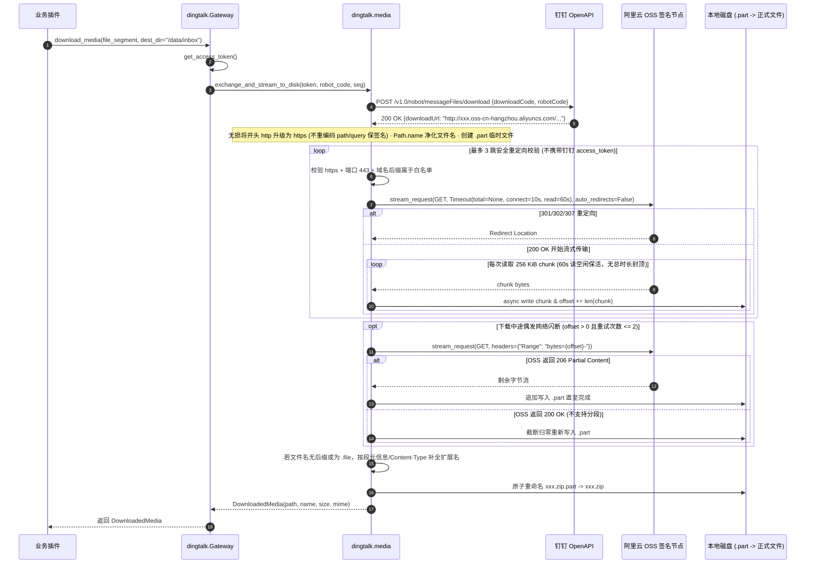
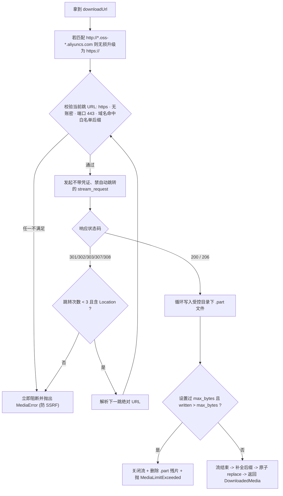
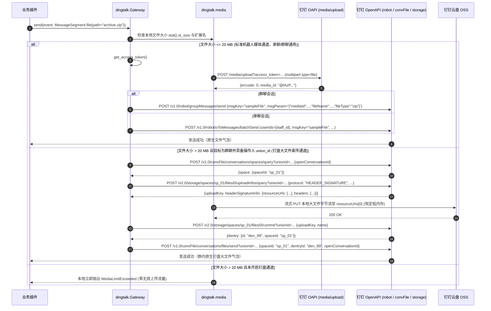

# 03. 多模态富媒体与 GB 级大文件收发专项设计

本文档定义图片、普通文件、语音、视频的入站流式拉取与出站上传投递方案，重点解决 **钉钉单聊最高 4GB 大文件恒定内存流式下载、`Range` 断点续传、OSS 签名链接安全校验** 以及 **出站 20MB 分界线双通道投递**。

---

## 1. 入站与出站能力边界对照

钉钉开放平台对媒体收发采用不对称架构，适配器必须分别针对性设计：

| 方向 | 钉钉底层机制 | 平台体积上限 | 适配器策略 |
| :--- | :--- | :--- | :--- |
| **入站下载** | `POST /v1.0/robot/messageFiles/download` 将 `downloadCode` 换为**阿里云 OSS 临时签名直链** | 随钉钉客户端上限（最高 **4 GB**） | 默认不设体积封顶（`max_download_bytes=None`），**流式直写 `.part` 临时文件 + 读空闲超时 + `Range` 续传**，内存占用恒定 < 1 MB |
| **出站常规媒体** | `POST https://oapi.dingtalk.com/media/upload` 换取 `media_id` 后发 `sample*` 模板消息 | 图片/视频/文件 **≤ 20 MB**，语音 **≤ 2 MB** | 本地预检文件大小与格式头，自动上传换 `media_id` 并按单聊/群聊投递原生气泡 |
| **出站超大文件** | 群钉盘空间 `convFile` + 存储 `uploadInfos` 获取 OSS 凭证直传 `PUT` | 突破 20 MB（GB 级） | 提供 `send_dingpan_file()` 流式 `PUT` 直传群钉盘并投递原生群文件卡片；无钉盘权限时抛 `MediaLimitExceeded` 或引导发送预签名下载卡片 |

---

## 2. 入站三层媒体读取接口设计

为防止业务插件在处理几百 MB 日志包或视频时误将文件读入内存导致 OOM，`Gateway` 明确划分三个层次的读取接口：

| 接口签名 | 返回值 | 内存特征 | 适用场景 |
| :--- | :--- | :--- | :--- |
| `await gateway.download_media(target, dest_dir=None, filename=None, max_bytes=None)` | `DownloadedMedia(path, name, size, mime)` | **恒定 O(1)**（仅驻留单块 256 KiB 缓冲） | **默认推荐**：落盘处理文件、归档、解压、离线分析 |
| `gateway.iter_media(target, chunk_size=262144)` | `AsyncIterator[bytes]` | **恒定 O(1)** | 在线流式计算哈希（SHA256）、流式管道转传至自有 S3/OSS |
| `await gateway.read_media_bytes(target, max_bytes=33554432)` | `bytes` | **O(N)**（默认强制 32 MB 内存保护上限） | 仅用于小图片/小配置文件直传多模态大模型 API |

> `target` 参数既支持直接传入入站 `MessageSegment`（`image` / `file` / `audio` / `video`），也支持直接传入裸 `download_code: str`。

---

## 3. 时序图 4：GB 级大文件流式下载与 `Range` 断点续传全流程

---

## 4. 入站下载安全防护决策流

---

## 5. 时序图 5：出站文件双通道发送（≤ 20MB 标准通道 vs > 20MB 钉盘直传）

---

## 6. 出站 OpenAPI 消息模板（`msgKey` / `msgParam`）精确映射表

注意钉钉机器人 OpenAPI 要求顶层字段 **`msgParam` 必须是序列化后的 JSON 字符串**：

| 段类型 | `msgKey` | `msgParam` 内层 JSON 结构 | 本地预检约束 |
| :--- | :--- | :--- | :--- |
| `text` | `sampleText` | `{"content": "..."}` | 非空文本 |
| `markdown` | `sampleMarkdown` | `{"title": "...", "text": "..."}` | `title` 供会话列表首屏预览 |
| `image` | `sampleImageMsg` | `{"photoURL": "<media_id 或公网 https URL>"}` | 本地上传 ≤ 20MB，支持 PNG / JPEG / GIF / BMP |
| `file` | `sampleFile` | `{"mediaId": "<media_id>", "fileName": "a.pdf", "fileType": "pdf"}` | 本地上传 ≤ 20MB，必须具备非空 ASCII 扩展名 `fileType` |
| `audio` | `sampleAudio` | `{"mediaId": "<media_id>", "duration": "4000"}` | 本地上传 ≤ 2MB，必须提供毫秒数字符串 `duration` |
| `video` | `sampleVideo` | `{"videoMediaId": "<vid>", "videoType": "mp4", "duration": "12000", "picMediaId": "<pic_id>"}` | 视频 ≤ 20MB MP4，需同时上传封面图换取 `picMediaId` |
| `action_card` | `sampleActionCard` | `{"title": "...", "text": "...","singleTitle": "...", "singleURL": "..."}` | 支持单按钮跳转（复杂多按钮交互统一走互动卡片接口） |
