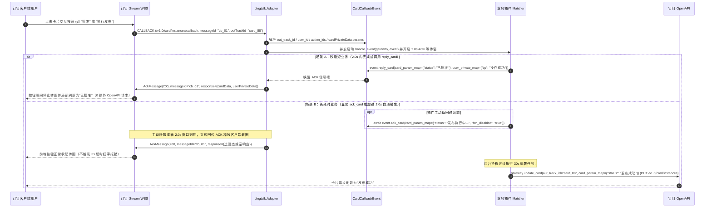
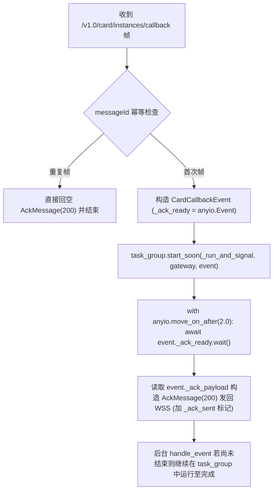
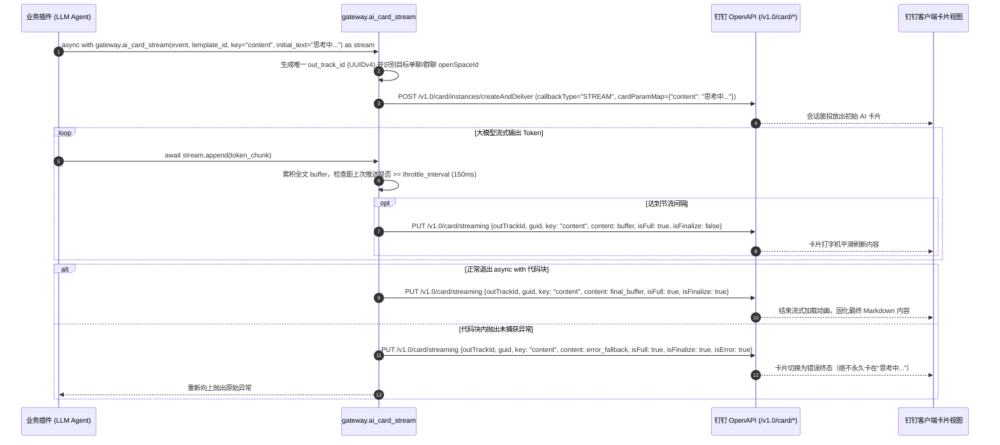

# 04. 互动卡片回调与 AI 流式打字机卡片设计

本文档定义钉钉 **互动卡片按钮交互回调（`/v1.0/card/instances/callback`）** 与 **AI 流式打字机卡片（`createAndDeliver` + `/v1.0/card/streaming`）** 的完整协同设计。

---

## 1. 核心痛点与架构对策

1. **痛点 1：忘记声明 `callbackType="STREAM"` 导致点按钮无响应**
   - 钉钉投放卡片接口默认 `callbackType="HTTP"`。适配器在 `create_and_deliver_card()` 中**默认强制写入 `"callbackType": "STREAM"`**，并在握手时默认订阅 `/v1.0/card/instances/callback`。
2. **痛点 2：前端按钮约 3 秒等待 ACK 超时报错 vs 后端长耗时业务冲突**
   - 用户点击卡片按钮后，钉钉客户端转圈等待 WebSocket `AckMessage` 仅约 **3 秒**：
     - 短业务（如“批准 / 拒绝”）希望直接随 `AckMessage` 带回新 `cardParamMap`，省去一次额外 HTTP 调用；
     - 长业务（如“执行生产部署”，耗时 30 秒）若等跑完再回 ACK，客户端在第 3 秒就会弹出“请求超时”错误提示。
   - **双模式抢占方案**：适配器为每个 `CardCallbackEvent` 建立 `anyio.Event` 信号槽并启动 **2.0 秒超时守护（`dingtalk_card_ack_timeout`）**：
     - 若插件在 2.0 秒内调用 `event.reply_card(...)` 或处理完毕 → **快路径**：直接把更新参数装入 WebSocket `AckMessage` 同步带回钉钉；
     - 若插件调用 `await event.ack_card(...)` 提前释放，或处理耗时满 2.0 秒仍未结束 → **慢路径**：自动先把过渡态（或空响应）`AckMessage` 发回钉钉收起前端转圈，后台业务协程继续无损运行，完成后调用 `await gateway.update_card(...)`（`PUT /v1.0/card/instances`）完成最终状态更新。
3. **痛点 3：大模型 Token 逐字输出触发钉钉流式接口高频限流与异常卡死**
   - LLM 流式接口每秒可能产生数十个 chunk；若逐个调用 `PUT /v1.0/card/streaming` 极易触发钉钉接口限流，且一旦业务抛异常未发 `isFinalize=true`，卡片会永久停留在“正在输入...”加载态。
   - **`ai_card_stream` 上下文管理器方案**：内置最小刷新间隔节流缓冲（默认 `150ms` 合并一次增量文本），并在 `__aexit__` 中保证：**正常退出必发 `isFinalize=true`，异常退出必发 `isError=true` 收尾**。

---

## 2. 时序图 6：互动卡片按钮回调快慢双路径时序

---

## 3. 卡片回调 2.0 秒抢占协调逻辑（`adapter.py` & `event.py`）

---

## 4. 时序图 7：AI 流式打字机卡片全生命周期（`gateway.ai_card_stream`）

---

## 5. 卡片接口空间参数（`openSpaceId`）自动推导规则

钉钉新版卡片投放接口 `POST /v1.0/card/instances/createAndDeliver` 使用统一的 `openSpaceId` 语法，适配器在 `gateway.py` 中自动根据 `event` 或入参拼接，免去业务侧记忆复杂格式：

| 投放目标场景 | `openSpaceId` 自动构造格式 | 附带投放场域字段 |
| :--- | :--- | :--- |
| **群聊会话**（`GroupMessageEvent` 或传 `open_conversation_id`） | `dtv1.card//IM_GROUP.{open_conversation_id}` | `imGroupOpenSpaceModel` + `imGroupOpenDeliverModel: {"robotCode": ...}` |
| **单聊会话**（`PrivateMessageEvent` 或传 `user_id`） | `dtv1.card//IM_ROBOT.{user_id}` | `imRobotOpenSpaceModel` + `imRobotOpenDeliverModel: {"spaceType": "IM_ROBOT"}` |
